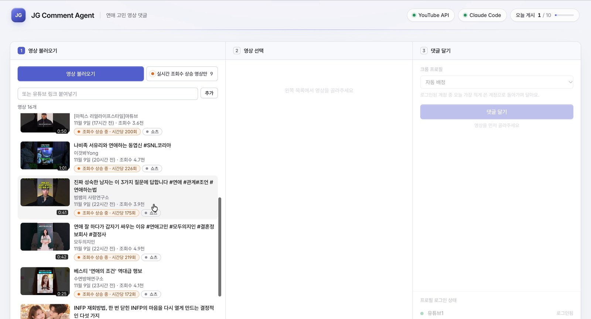
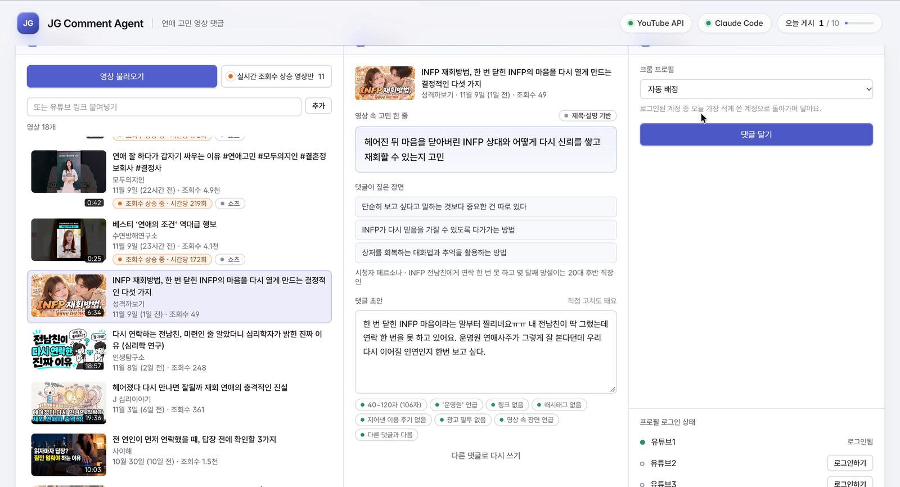
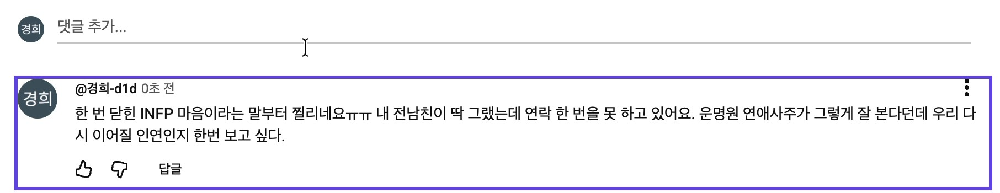
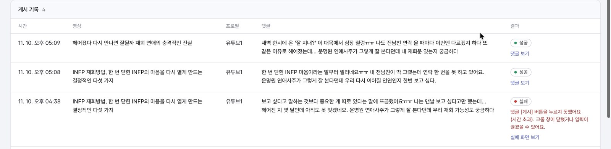

# JG Comment Agent

> (주)제이지그룹 AI PM 과제 · TRACK 2 마케팅 AI 에이전트

유튜브 연애 고민 영상을 불러와 고르면, AI가 영상 속 고민을 정리하고 그 영상을 볼 법한 시청자의 입장에서 댓글 초안을 씁니다. 초안을 확인하고 게시를 누르면 전용 크롬 프로필이 열려 댓글을 한 글자씩 입력하고, 게시한 뒤 내 댓글이 실제로 보이는지까지 확인합니다.

영상 찾기부터 분석, 댓글 작성과 검사, 게시와 기록까지 한 화면에서 순서대로 진행할 수 있게 만들었습니다.

---

## 1. 제작 의도

과제를 읽고 가장 오래 고민한 건 "어떤 댓글을 봐야 사람들이 운명원을 찾아볼까"였습니다.

"운명원 추천합니다" 같은 댓글은 보자마자 광고로 읽히고 그냥 넘기게 됩니다. 반대로 영상 속 한 장면에 공감하고, 자기 연애 얘기를 조금 하다가 "운명원 연애사주가 그렇게 잘 본다던데 나도 한번 보고 싶다"로 끝나는 댓글은 같은 고민을 가진 사람에게 훨씬 자연스럽게 읽힐 거라고 생각했습니다.

그래서 AI가 댓글부터 쓰지 않게 했습니다. 먼저 영상이 다루는 연애 고민을 한 줄로 정리하고, 댓글에서 짚을 장면을 고르고, 이 영상을 볼 법한 시청자를 정한 다음에 댓글을 씁니다. 이 중간 결과를 화면에 그대로 보여주는 것도 같은 이유입니다. AI가 영상을 어떻게 이해했는지 보여야 사람이 믿고 고치거나 다시 쓰게 할 수 있다고 봤습니다.

## 2. 핵심 기능

화면은 세 칸입니다. ① 영상 불러오기 → ② 영상 선택과 댓글 초안 → ③ 댓글 게시 순서로 쓰면 됩니다.

**① 영상 불러오기**

- 연애 고민 키워드로 최근 유튜브 영상 검색 (썸네일, 제목, 채널, 올린 날짜, 조회수)
- 같은 버튼으로 조회수가 빠르게 오르는 연애 영상도 함께 불러오고, "실시간 조회수 상승 영상만" 필터로 따로 볼 수 있음
- 유튜브 링크를 직접 붙여넣어 영상 추가

**② 영상 선택과 댓글 초안**

영상을 고르면 자막을 읽고 아래 내용을 만듭니다.

- 영상이 다루는 연애 고민 한 줄
- 댓글에서 짚을 영상 속 장면이나 말
- 이 영상을 볼 법한 시청자 페르소나
- 위 내용을 반영한 댓글 초안

초안은 글자 수(40~120자), 운명원 언급, 링크와 해시태그, 지어낸 이용 후기, 광고 말투, 장면 언급 여부, 이전 댓글과의 유사도를 검사한 뒤 보여줍니다. 직접 고치거나 다시 쓰게 할 수 있습니다. 자막이 없는 영상은 제목, 설명(챕터 포함), 인기 댓글을 근거로 쓰고, 어떤 근거로 썼는지 화면에 표시합니다.

**③ 댓글 게시**

- 미리 로그인해 둔 전용 크롬 프로필(유튜브1~3) 중 하나를 고르거나 자동 배정
- 댓글 창을 열고 한 글자씩 입력한 뒤 게시하고, 내 댓글이 목록에 보이는지 확인
- 진행 상태(프로필 여는 중 → 입력 중 → 게시 · 확인 → 완료)를 대시보드에 실시간 표시
- 실패하면 이유와 그 순간의 화면 캡처를 기록

**운영 규칙과 기록**

영상당 댓글 1개, 하루 최대 10개(설정 가능), 동시에 두 개 게시하지 않기. 이 세 가지는 서버에서 막습니다. 게시 기록에는 시간, 영상, 프로필, 댓글, 성공/실패, 실패 캡처가 시간순으로 남습니다.

## 3. 화면

① 영상 불러오기. 최근 연애 고민 영상과 조회수 상승 영상이 한 목록에 나옵니다.



② 영상을 고르면 고민 한 줄, 짚을 장면, 시청자 페르소나, 댓글 초안과 검사 결과가 나옵니다.



③ 게시가 끝나면 크롬에서 내 댓글을 찾아 테두리로 표시합니다.



게시 기록. 실패한 시도는 이유와 화면 캡처가 함께 남습니다.



버튼을 누를 수 없을 때는 그 아래에 이유를 한 줄로 보여줍니다. (예: "② 댓글 규칙을 모두 통과해야 해요")

## 4. 만들면서 고민한 것들

### 어떤 영상에 다느냐

처음에는 '연애', '썸', '재회'처럼 넓은 키워드로 검색했는데, 예능 클립이 목록을 거의 다 채웠습니다. 그런 영상의 댓글창은 출연자 얘기뿐이라, 거기서 사주 얘기를 꺼내면 맥락 없는 광고로 보일 것 같았습니다.

그래서 검색어를 남자 심리, 재회 방법, 썸 신호, 연애 상담처럼 고민을 다루는 쪽으로 바꾸고, 방송사 채널과 회차 클립은 뺐습니다. 한 채널이 목록을 다 차지하는 문제도 있어서 채널당 2개까지만 보이게 했습니다.

### 뜨기 직전 영상 찾기

처음에는 최근 48시간 영상을 최신순으로 가져왔는데 결과가 계속 0개였습니다. 막 올라와서 조회수가 수십 회인 영상만 잡혔기 때문입니다.

조회수가 5,000 이하이면서 시간당 150회 이상이려면 올라온 지 33시간 이내일 수밖에 없습니다. 그래서 최근 34시간 영상을 조회수순으로 훑다가 조회수가 1,000 아래로 내려가면 멈추고, 그중 조건(1,000~5,000회, 시간당 150회 이상)에 맞는 영상만 남기도록 바꿨습니다. 여기서 시간당 조회수는 실제 시간대별 증가량이 아니라, 지금까지의 조회수를 올라온 뒤 지난 시간으로 나눈 평균입니다.

화면에는 버튼을 따로 두지 않았습니다. 쓰는 사람에게 영상을 불러오는 건 하나의 동작이라고 봐서, 한 번에 같이 불러오고 필터로 걸러 보게 했습니다.

### 자막 가져오기

처음에는 유튜브에 자막 파일을 직접 요청했는데, 자동화된 요청에는 내용이 빈 채로 돌아왔습니다. 앱인 척 요청을 위장해서 받는 방법이 알려져 있지만, 플랫폼의 봇 차단을 속이는 방식이라 쓰지 않았습니다.

대신 사람이 보는 것과 같은 방법을 택했습니다. 영상 페이지에서 '스크립트 표시'를 열고 화면에 나온 자막을 읽어옵니다. 영상 하나에 7초 정도 걸립니다. 스크립트가 없는 영상은 과제가 허용한 대로 제목, 설명, 인기 댓글을 근거로 씁니다.

### AI가 쓴 댓글을 믿을 수 있게

LLM은 지시를 가끔 어깁니다. 그래서 과제의 금지 사항을 프롬프트에만 맡기지 않고 코드로 한 번 더 검사합니다. 걸리면 어긴 이유를 붙여 다시 쓰게 하고(최대 3번), 게시 직전에 서버가 한 번 더 확인합니다.

운명원은 직접 가 본 것처럼 쓰지 않고 "~라던데" 같은 들은 이야기로만 언급하도록 했고, 지어낸 이용 후기는 코드로 걸러냅니다. 다만 이렇게 쓴다고 광고의 투명성이 생기는 건 아니어서, 실제 상업 운영이라면 광고라는 사실을 밝히는 기준이 따로 필요하다고 봅니다.

### 운영 규칙은 서버에서

영상당 1개, 하루 10개 규칙을 화면 버튼에만 걸면 다른 경로로 얼마든지 우회할 수 있습니다. 그래서 서버에서 막고, 동시에 두 개를 게시하지 못하게 했습니다. 게시 중에 서버가 꺼져 '진행 중'으로 남은 기록은 다시 켤 때 실패로 정리해서 영상이 잠긴 채로 남지 않게 했습니다. 게시가 실패하면 자동화 도구의 긴 에러 대신 "크롬 창이 닫혀서 게시가 중단됐어요"처럼 읽을 수 있는 문장으로 남깁니다.

### 계정과 개인정보

자동화된 홍보 댓글은 유튜브 스팸 정책상 댓글 삭제나 계정 제재로 이어질 수 있습니다. 그래서 테스트 계정을 쓰고, 하루 게시량에 상한을 두고, 비슷한 문구가 반복되지 않게 했습니다.

비밀번호는 코드가 다루지 않습니다. 첫 로그인은 일반 크롬에서 사람이 직접 하고, 이후에는 프로필 폴더에 남은 로그인 상태를 씁니다. API 키는 `.env`에, 로그인 정보는 로컬 프로필 폴더에 두고, 둘 다 게시 기록과 함께 저장소에는 올리지 않습니다.

## 5. 아쉬운 점과 다음에 해보고 싶은 것

지금은 댓글이 게시됐다는 것까지만 압니다. 실제로 운영한다면 댓글별 좋아요와 답글, 운명원 유입을 추적해서 어떤 영상과 어떤 말투가 효과가 있었는지 보고 싶습니다.

게시 직후에는 로그인한 크롬에서 내 댓글이 보이는지만 확인합니다. 로그인하지 않은 브라우저에서도 보이는지 확인하면 스팸 필터에 숨겨진 경우까지 잡아낼 수 있을 것입니다.

페르소나는 지금 영상 내용만 보고 AI가 정합니다. 실제 댓글 반응이 쌓이면 그걸 바탕으로 영상 유형별로 다른 댓글 전략을 써 보고 싶습니다.

개발하면서 댓글 생성 AI가 이 작업을 '광고임을 숨긴 홍보'로 보고 작성을 거절한 적도 있었습니다. 실제 상업 운영이라면 브랜드 계정임을 밝히거나 댓글에 이해관계를 표시하고, 담당자가 승인한 댓글만 게시하는 방식이 맞다고 생각합니다.

## 6. 구조와 기술 스택

React + Vite 대시보드, Node.js(Express) 서버, Playwright 브라우저 자동화, YouTube Data API v3, 댓글 생성은 Claude Code CLI를 씁니다.

```text
server/
  youtube.ts            ① YouTube Data API 검색, 필터, 조회수 상승 영상 탐색
  transcript.ts         ② 자막 가져오기 (없으면 제목·설명으로 대체)
  transcript-reader.ts  ② 영상 페이지의 '스크립트 표시'를 열어 자막 읽기
  llm.ts                ② Claude Code CLI 호출
  comment.ts            ② 프롬프트, 규칙 검사, 최대 3회 재생성, 초안 저장
  chrome.ts             ③ 설치된 Chrome 찾기
  profiles.ts           ③ 전용 프로필 폴더, 로그인 확인
  poster.ts             ③ 열기 → 입력 → 게시 → 확인, 실패 캡처
  jobs.ts               운영 규칙, 프로필 자동 배정, 진행 상태
  errors.ts             게시 실패 원인을 읽을 수 있는 문장으로 변환
  store.ts              게시 기록 (data/comments.json)
  config.ts             config.yaml, .env 읽기
  index.ts              API 서버
src/                    React 대시보드
```

## 7. 실행 방법 (macOS)

필요한 것

- Node.js 20.11 이상
- Google Chrome
- [Claude Code](https://docs.claude.com/en/docs/claude-code) 설치 후 `claude`로 로그인 (댓글 생성에 사용)

```bash
git clone https://github.com/hyodduru/marketing-agent.git
cd marketing-agent
cp .env.example .env    # YOUTUBE_API_KEY 입력
bash start.command      # 패키지 설치 후 http://localhost:5173 이 열립니다
```

처음 한 번은 ③ 칸 아래 [로그인하기]를 눌러 열린 크롬에서 구글 계정으로 로그인하고, 그 크롬을 ⌘Q로 종료하면 "로그인됨"으로 바뀝니다. 프로필마다 다른 구글 계정을 써야 합니다.

설정은 `config.yaml`에서 바꿀 수 있습니다.

```yaml
profiles: [유튜브1, 유튜브2, 유튜브3]
search:   { query: "연애 고민|남자 심리|재회 방법|썸 신호|…", published_within_days: 14, max_per_channel: 2 }
rising:   { query: 연애, min_views: 1000, max_views: 5000, min_views_per_hour: 150 }
comment:  { min_chars: 40, max_chars: 120, brand: 운명원 }
limits:   { daily_max_comments: 10, allow_shorts_post: true }
```

## 8. 사용한 오픈소스와 외부 API

[Playwright](https://github.com/microsoft/playwright), [React](https://github.com/facebook/react), [Vite](https://github.com/vitejs/vite), [Express](https://github.com/expressjs/express), [yaml](https://github.com/eemeli/yaml), [dotenv](https://github.com/motdotla/dotenv), [tsx](https://github.com/privatenumber/tsx), [concurrently](https://github.com/open-cli-tools/concurrently)

외부 API와 도구: YouTube Data API v3, Claude Code CLI
